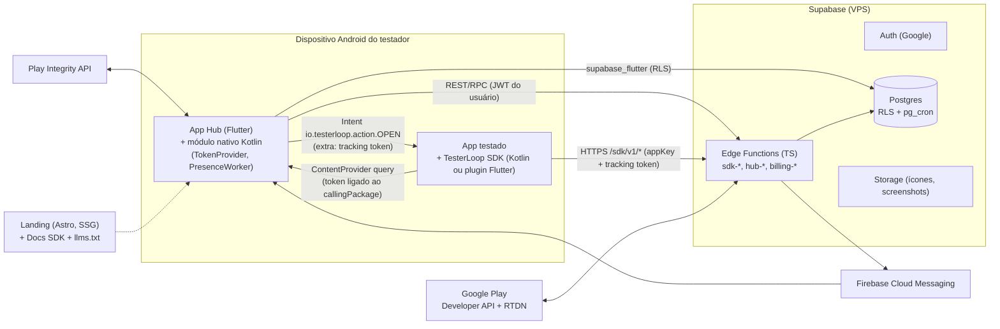
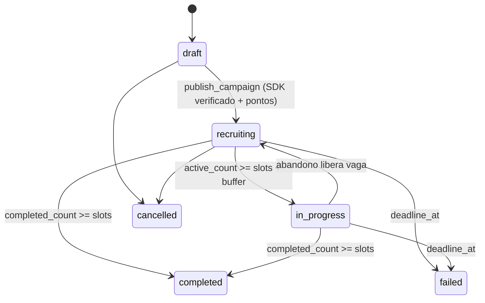
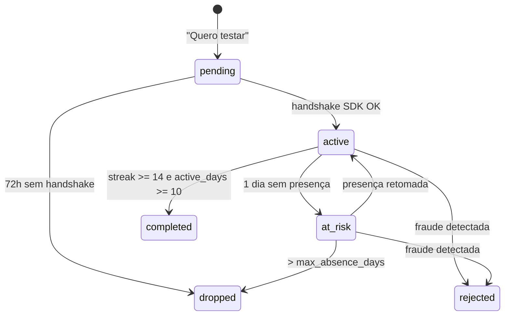
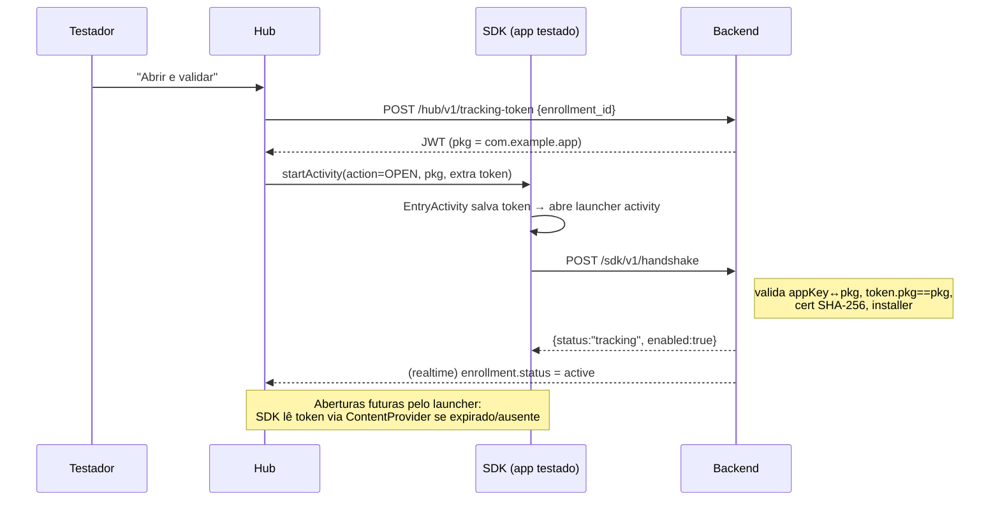

# SPEC técnica — TesterLoop (nome provisório)

> **Status:** Rascunho v0.2 · **Data:** 2026-11-13
> Complementa o [`PRD.md`](./PRD.md). Pontos de produto em aberto: **OQ-9** e **OQ-18** (PRD §12). Pontos técnicos em aberto: **TQ-n** (§15).

---

## 1. Visão geral da arquitetura



### Componentes
| Componente | Tecnologia | Repositório/pasta |
|---|---|---|
| App Hub | Flutter (Android no MVP, Flutter Web para o console na fase 2) | `apps/hub` |
| SDK Android | Kotlin, AAR no Maven Central | `packages/sdk-android` |
| Plugin Flutter | Plugin Flutter (só Android, no-op em outras plataformas) no pub.dev | `packages/sdk-flutter` |
| Backend | Supabase self-hosted em VPS (Postgres 15+, Edge Functions Deno/TS, Storage, Auth, pg_cron) | `backend/supabase` |
| Push | Firebase Cloud Messaging | — |
| Landing + Docs | Astro (SSG) + Starlight em `/docs` | `apps/landing` |

**Monorepo** (sugerido) com **Melos** para os pacotes Dart:
```
testerloop/
├─ apps/
│  ├─ hub/                 # Flutter app
│  └─ landing/             # Astro
├─ packages/
│  ├─ sdk-android/         # Kotlin library (+ sample app)
│  ├─ sdk-flutter/         # Flutter plugin (+ example/)
│  └─ shared-contracts/    # JSON Schemas / OpenAPI da API do SDK
├─ backend/supabase/
│  ├─ migrations/
│  ├─ functions/
│  └─ seed.sql
├─ docs/                   # PRD, SPEC, ADRs
└─ .github/workflows/
```

---

## 2. Conceitos de domínio

| Termo | Definição |
|---|---|
| **App** | App Android cadastrado por um dev (único por `package_name`). |
| **Campanha** | Rodada de teste fechado de um App: vagas, duração e custo. Um App pode ter várias ao longo do tempo, mas só uma ativa. |
| **Inscrição (Enrollment)** | Vínculo testador × campanha. |
| **Dia presente** | Dia em que o app testado continuava instalado (confirmado pelo SDK ou pelo `PresenceWorker` do Hub). |
| **Dia ativo** | Dia com ≥ `min_foreground_seconds` (padrão 60s) de uso em foreground, segundo o SDK. |
| **Sequência (streak)** | Dias presentes consecutivos. Cai para 0 se o app não for visto por `max_absence_days` (padrão 2). |
| **Conclusão da inscrição** | `streak ≥ required_days (14)` **e** `active_days ≥ min_active_days (10)`. |
| **Conclusão da campanha** | ≥ `slots (12)` inscrições concluídas. |

> Os parâmetros ficam na tabela `config` e são copiados para a campanha no momento da publicação, de modo que mudanças futuras não afetem campanhas em andamento.

---

## 3. Backend

### 3.1 Por que Supabase self-hosted em VPS (OQ-17)
- **Ledger de pontos** e transações atômicas (publicar campanha = debitar pontos + mudar status) ficam naturais em SQL.
- Rankings ("mais testadores", "recentes") são queries simples com índice. No Firestore, exigiriam contadores desnormalizados.
- Constraints de exclusão (`EXCLUDE USING gist`) impedem dois Featured no mesmo slot e horário.
- RLS permite que o Hub leia direto do banco com segurança. A lógica sensível fica em Edge Functions e RPCs `security definer`.
- `supabase_flutter` é maduro.
- **Hospedagem em VPS (self-hosted):** stack oficial via Docker Compose (Postgres, GoTrue/Auth, PostgREST, Realtime, Storage, Deno Edge Runtime, Kong e `pg_cron`) atrás de proxy reverso com TLS, garantindo custo fixo e previsível (sem cobrança por MAU ou egress da nuvem gerenciada), com backups automatizados do volume Postgres.
- **Alternativa descartada:** Firebase (Firestore + Functions), onde ledger e rankings ficam mais trabalhosos.

### 3.2 Modelo de dados (DDL resumido)

```sql
-- ===== Identidade =====
create table profiles (
  id            uuid primary key references auth.users on delete cascade,
  display_name  text not null,
  avatar_url    text,
  locale        text not null default 'pt-BR',
  timezone      text not null default 'America/Sao_Paulo',
  reputation    numeric(4,3) not null default 1.000,   -- 0..1
  fcm_token     text,
  banned_at     timestamptz,
  created_at    timestamptz not null default now()
);

create table devices (
  id                uuid primary key default gen_random_uuid(),
  user_id           uuid not null references profiles on delete cascade,
  android_id_hash   text not null unique,              -- SHA-256(ANDROID_ID + pepper) do Hub
  model             text, sdk_int int,
  integrity_ok_at   timestamptz,                       -- última verificação Play Integrity OK
  last_seen_at      timestamptz
);

-- ===== Apps & campanhas =====
create table apps (
  id                   uuid primary key default gen_random_uuid(),
  owner_id             uuid not null references profiles,
  package_name         text not null unique,
  name                 text not null,
  short_description    text not null check (char_length(short_description) <= 80),
  description          text,
  category             text,
  icon_path            text,
  screenshots          text[] default '{}',
  play_optin_url       text not null,                  -- https://play.google.com/apps/testing/<pkg>
  app_key              text not null unique,           -- tl_pk_<random> (público)
  signing_cert_sha256  text,                           -- gravado na validação via Play (TOFU)
  sdk_debug_ok_at      timestamptz,
  sdk_verified_at      timestamptz,                    -- validação com build da Play
  created_at           timestamptz not null default now()
);

create type campaign_status as enum
  ('draft','recruiting','in_progress','completed','failed','cancelled');

create table campaigns (
  id                 uuid primary key default gen_random_uuid(),
  app_id             uuid not null references apps on delete cascade,
  status             campaign_status not null default 'draft',
  slots              int not null default 12,
  buffer_slots       int not null default 3,          -- OQ-3
  required_days      int not null default 14,         -- OQ-1
  min_active_days    int not null default 10,
  cost_points        int not null,
  active_count       int not null default 0,          -- mantido por trigger
  completed_count    int not null default 0,
  published_at       timestamptz,
  deadline_at        timestamptz,                     -- published_at + 45d → failed
  completed_at       timestamptz,
  created_at         timestamptz not null default now()
);
create unique index one_live_campaign_per_app on campaigns(app_id)
  where status in ('recruiting','in_progress');
create index campaigns_recent on campaigns(published_at desc) where status = 'recruiting';
create index campaigns_popular on campaigns(active_count desc) where status = 'recruiting';

create type enrollment_status as enum
  ('pending','active','at_risk','completed','dropped','rejected');

create table enrollments (
  id                 uuid primary key default gen_random_uuid(),
  campaign_id        uuid not null references campaigns on delete cascade,
  tester_id          uuid not null references profiles,
  device_id          uuid not null references devices,
  kind               text not null default 'tester' check (kind in ('tester','owner_validation')),
  status             enrollment_status not null default 'pending',
  enrolled_at        timestamptz not null default now(),
  first_handshake_at timestamptz,
  streak_days        int not null default 0,
  active_days        int not null default 0,
  last_present_day   date,
  last_active_day    date,
  completed_at       timestamptz,
  dropped_at         timestamptz,
  drop_reason        text,
  unique (campaign_id, tester_id)
);

create table daily_activity (
  enrollment_id      uuid references enrollments on delete cascade,
  day                date,                            -- dia local do testador
  present            boolean not null default false,
  foreground_seconds int not null default 0,
  sessions           int not null default 0,
  sources            text[] not null default '{}',    -- {'sdk','hub_presence'}
  primary key (enrollment_id, day)
);

-- Eventos crus do SDK (auditoria/antifraude). Particionar por mês, TTL de 60 dias.
create table sdk_events (
  id            bigint generated always as identity,
  received_at   timestamptz not null default now(),
  app_id        uuid not null,
  enrollment_id uuid,
  install_id    text not null,
  type          text not null,                        -- handshake | session | ping
  payload       jsonb not null
) partition by range (received_at);

-- ===== Pontos (ledger imutável, só INSERT) =====
create type ledger_kind as enum
  ('earn_pending','release','forfeit','spend_campaign','refund_campaign',
   'bonus_welcome','bonus_completion','bonus_feedback','admin_adjust','expire');

create table points_ledger (
  id          bigint generated always as identity primary key,
  user_id     uuid not null references profiles,
  kind        ledger_kind not null,
  bucket      text not null check (bucket in ('pending','available')),
  amount      int not null,                           -- +crédito / -débito
  ref_type    text, ref_id uuid,
  created_at  timestamptz not null default now()
);
create view wallet as
  select user_id,
         coalesce(sum(amount) filter (where bucket='available'),0) as available,
         coalesce(sum(amount) filter (where bucket='pending'),0)   as pending
  from points_ledger group by user_id;

-- ===== Feedback =====
create table feedback (
  id            uuid primary key default gen_random_uuid(),
  enrollment_id uuid not null unique references enrollments on delete cascade,
  rating        int check (rating between 1 and 5),
  liked         text, issues text, suggestion text,
  status        text not null default 'submitted' check (status in ('submitted','approved','rejected')),
  created_at    timestamptz not null default now()
);

-- ===== Featured & billing =====
create table featured_products (
  id              text primary key,                   -- 'featured_24h' = productId no Play
  duration_hours  int not null,
  active          boolean not null default true
);

create extension if not exists btree_gist;
create table featured_bookings (
  id           uuid primary key default gen_random_uuid(),
  campaign_id  uuid not null references campaigns,
  slot_index   int not null check (slot_index between 1 and 3),
  period       tstzrange not null,
  purchase_id  uuid references purchases,
  status       text not null default 'reserved' check (status in ('reserved','confirmed','cancelled')),
  exclude using gist (slot_index with =, period with &&) where (status <> 'cancelled')
);

create table purchases (
  id              uuid primary key default gen_random_uuid(),
  user_id         uuid not null references profiles,
  product_id      text not null references featured_products,
  purchase_token  text not null unique,
  order_id        text,
  state           text not null,                      -- pending|purchased|consumed|refunded
  raw             jsonb,
  created_at      timestamptz not null default now()
);

-- ===== Diversos =====
create table config (key text primary key, value jsonb not null);
create table abuse_reports (id uuid primary key default gen_random_uuid(),
  reporter_id uuid references profiles, target_type text, target_id uuid,
  reason text, created_at timestamptz default now());
```

> **Nota:** a ordem real das migrations é diferente (por exemplo, `purchases` vem antes de `featured_bookings`). O DDL acima serve de referência conceitual.

### 3.3 RLS (resumo)
| Tabela | Leitura | Escrita |
|---|---|---|
| `profiles` | Própria linha; `display_name`/`avatar` públicos via view | Própria linha (campos limitados) |
| `apps`, `campaigns` | Públicas quando `status in (recruiting, in_progress)`; o dono vê tudo | Dono, apenas `draft`. Publicação só via RPC |
| `enrollments`, `daily_activity` | Testador (as próprias) e dono do app (as da campanha, sem `device_id`) | **Só backend** |
| `points_ledger`, `wallet` | Próprio usuário | **Só backend** |
| `featured_bookings` | Públicas (as ativas) | **Só backend** |

### 3.4 Edge Functions / RPCs

| Endpoint | Chamador | Descrição |
|---|---|---|
| `POST /hub/v1/device/register` | Hub | Envia `android_id_hash` + token Play Integrity. Garante 1 conta por dispositivo. |
| `POST /hub/v1/enrollments` | Hub | `{campaign_id}` → cria inscrição `pending`. Valida o limite de inscrições simultâneas, que o usuário não é dono do app e que ainda há vagas. |
| `POST /hub/v1/tracking-token` | Hub | `{enrollment_id}` → JWT ES256 (ver §4.3). |
| `POST /hub/v1/presence` | Hub (worker diário) | `{packages:[...]}` instalados com SDK → marca `present` para o dia. |
| `rpc publish_campaign(app_id)` | Hub | Transação: verifica `sdk_verified_at`, debita `cost_points`, `status=recruiting`. |
| `rpc cancel_campaign(id)` | Hub | Reembolso proporcional (❓ TQ-6). |
| `POST /sdk/v1/handshake` | SDK | Primeiro contato ou renovação do token (§4.4). |
| `POST /sdk/v1/events` | SDK | Lote de sessões e pings (§4.5). |
| `GET /sdk/v1/config?appKey=` | SDK | Kill-switch: `{enabled, flushIntervalSec}`. Com cache em CDN. |
| `POST /billing/v1/verify` | Hub | Verifica o `purchaseToken` na Play Developer API, cria a reserva e consome a compra. |
| `POST /billing/v1/rtdn` | Pub/Sub push | Reembolsos e anulações → cancela a reserva. |
| `POST /feedback` | Hub | Grava feedback. A aprovação pode ser automática (heurística de tamanho/qualidade) ou feita pelo dono do app. |

### 3.5 Jobs (pg_cron)
| Job | Frequência | Ação |
|---|---|---|
| `rollup_days` | a cada hora | Para inscrições cujo **dia local terminou**: atualiza `streak_days`, `active_days`, `status` (`at_risk` após 1 dia ausente, `dropped` após `max_absence_days`). Lança `earn_pending` por dia ativo. |
| `complete_enrollments` | a cada hora | Marca `completed` se cumprir a regra; lança `release` (pendente → disponível) + `bonus_completion`. Atualiza contadores da campanha. |
| `complete_campaigns` | a cada hora | `completed_count ≥ slots` → `completed`; push para o dono. `deadline_at` vencido → `failed`. |
| `daily_reminders` | a cada hora | Usuários cujo horário local é 19:00 e que têm inscrições sem atividade hoje → push. |
| `expire_points` | diário | Expira pontos após 360 dias de inatividade (OQ-7). |
| `featured_rotation` | a cada 5 min | Confirma/encerra reservas e invalida o cache do feed. |

### 3.6 Máquinas de estado





### 3.7 Feeds do Hub
```sql
-- Recentes
select * from feed_campaigns
where status = 'recruiting' and owner_id <> auth.uid()
  and id not in (select campaign_id from enrollments where tester_id = auth.uid())
order by published_at desc limit 20;

-- Mais testadores / quase completos (prova social: "9/12")
... order by active_count desc, published_at asc limit 20;

-- Featured
select c.* from featured_bookings b join feed_campaigns c on c.id = b.campaign_id
where b.status = 'confirmed' and now() <@ b.period order by b.slot_index;
```
> **Nota (OQ-3):** definido como **vagas por campanha** (12 + 3 de reserva); o feed mantém paginação de 20 itens por aba.

---

## 4. Protocolo de rastreamento (SDK ↔ Hub ↔ Backend)

### 4.1 Requisitos de projeto
1. **Sem PII no app testado:** o SDK não sabe quem é o testador, só carrega um token opaco.
2. **Instalação trivial:** sem código obrigatório.
3. **Funciona com o app aberto pelo launcher** (não só pelo Hub).
4. **Compatível com package visibility (Android 11+)** sem `QUERY_ALL_PACKAGES`, que é restrita pela política do Play.

### 4.2 Peças no dispositivo

**No SDK (manifest da lib, mesclado automaticamente):**
```xml
<manifest xmlns:android="http://schemas.android.com/apk/res/android">
  <uses-permission android:name="android.permission.INTERNET"/>
  <queries>
    <!-- Permite ao SDK consultar o provider do Hub -->
    <provider android:authorities="io.testerloop.hub.token"/>
  </queries>
  <application>
    <!-- Trampolim: o Hub abre o app por aqui, passando o token; depois repassa para a launcher activity -->
    <activity
      android:name="io.testerloop.sdk.internal.EntryActivity"
      android:exported="true"
      android:excludeFromRecents="true"
      android:noHistory="true"
      android:theme="@android:style/Theme.Translucent.NoTitleBar">
      <intent-filter>
        <action android:name="io.testerloop.action.OPEN"/>
        <category android:name="android.intent.category.DEFAULT"/>
      </intent-filter>
    </activity>
    <!-- Auto-init via androidx.startup -->
    <provider
      android:name="androidx.startup.InitializationProvider"
      android:authorities="${applicationId}.androidx-startup"
      android:exported="false"
      tools:node="merge">
      <meta-data android:name="io.testerloop.sdk.internal.TesterLoopInitializer"
                 android:value="androidx.startup"/>
    </provider>
  </application>
</manifest>
```

**No Hub:**
```xml
<queries>
  <!-- Descobre TODOS os apps instalados que contêm o SDK, sem QUERY_ALL_PACKAGES -->
  <intent><action android:name="io.testerloop.action.OPEN"/></intent>
</queries>
<provider
  android:name=".tracker.TokenProvider"
  android:authorities="io.testerloop.hub.token"
  android:exported="true"/>
```

- **Descoberta e presença:** `packageManager.queryIntentActivities(Intent("io.testerloop.action.OPEN"), 0)` lista os packages com SDK instalados. Um `PresenceWorker` (WorkManager, 1×/dia) envia essa lista para `/hub/v1/presence`. Isso detecta **desinstalação** mesmo quando o testador não abre o app.
- **Token por package:** `TokenProvider.query()` usa `callingPackage` (verificado pelo sistema) e devolve **apenas** o token da inscrição cujo `package_name == callingPackage`. Um app não consegue obter o token de outro.

### 4.3 Tracking token (JWT ES256, emitido pelo backend)
```json
{
  "iss": "testerloop", "aud": "sdk",
  "sub": "<enrollment_id>",
  "pkg": "com.example.app",
  "kind": "tester | owner_validation",
  "tz": "America/Sao_Paulo",
  "iat": 1731400000, "exp": 1734000000
}
```
- Validade de 30 dias, renovável. Revogado implicitamente quando a inscrição sai de `active`/`at_risk`.
- O SDK trata o token como opaco e nunca o decodifica.

### 4.4 Handshake



**Request:**
```json
POST /sdk/v1/handshake
{
  "appKey": "tl_pk_8f3c...",
  "packageName": "com.example.app",
  "versionCode": 42,
  "signingCertSha256": "AB:CD:...",
  "installer": "com.android.vending",
  "debuggable": false,
  "installId": "b7e1...-uuid",            // UUID aleatório gerado pelo SDK, persistido
  "sdk": {"platform":"android","version":"1.0.0","wrapper":"flutter|null"},
  "device": {"sdkInt": 35},
  "token": "<JWT ou null>"
}
```

**Regras de validação no servidor:**
| Verificação | Campanha (`tester`) | Validação do dono |
|---|---|---|
| `appKey` pertence ao `packageName` | obrigatório | obrigatório |
| `token.pkg == packageName` e inscrição viva | obrigatório | obrigatório |
| `installer == com.android.vending` | obrigatório | obrigatório para `sdk_verified_at` (com outro installer, só `sdk_debug_ok_at`) |
| `signingCertSha256 == apps.signing_cert_sha256` | obrigatório | **grava** na primeira validação via Play (TOFU) |
| `debuggable == false` | obrigatório | não obrigatório no modo debug |

> **Teste de launch do dono (H8):** etapa 1 com build debug local (confirma integração → `sdk_debug_ok_at`). Etapa 2 com build vindo do teste fechado no Play (confirma track e certificado → `sdk_verified_at`). **Só a etapa 2 libera a publicação.**

### 4.5 Eventos de uso
- `ProcessLifecycleOwner`: `ON_START` → registra `ping` + início de sessão. `ON_STOP` → fecha a sessão (`foregroundMs`).
- Fila persistida em arquivo (máx. 500 eventos, FIFO), enviada no `ON_START`, no `ON_STOP` e a cada `flushIntervalSec` com o app em foreground. Backoff exponencial em caso de falha.
- O servidor **atribui o dia pelo `received_at`** (no fuso `tz` do token) e usa o relógio do cliente só para durações. Sessões são truncadas em 4h.

```json
POST /sdk/v1/events
{
  "appKey": "...", "packageName": "...", "installId": "...", "token": "...",
  "events": [
    {"type":"ping",    "id":"e1", "clientTs": 1731400000123},
    {"type":"session", "id":"e2", "startTs": 1731400000123, "foregroundMs": 183000}
  ]
}
```
Resposta: `{"accepted":["e1","e2"], "enabled":true}`. O `id` garante idempotência.

### 4.6 Kill-switch e ciclo de vida
- `enabled:false` em qualquer resposta (ou em `/sdk/v1/config`) → o SDK grava a flag e vira **no-op**. Volta a checar a config 1×/semana.
- Depois que a campanha termina (`completed`/`failed`), o backend responde `enabled:false` para aquele `appKey`.
- Sem token (ex.: usuário de produção comum que não usa o Hub), o SDK **não envia nada** além de uma checagem de config por dia, no máximo.

---

## 5. SDK Android (Kotlin)

### 5.1 Requisitos não funcionais
| Item | Meta |
|---|---|
| `minSdk` | 23 (❓ TQ-3) |
| Tamanho | < 50 KB (AAR, depois do R8) |
| Dependências | Só `androidx.startup` e `androidx.lifecycle:lifecycle-process`, que quase todo app já tem. HTTP via `HttpURLConnection`, JSON via `org.json`. **Sem OkHttp, Retrofit ou coroutines na API pública.** |
| Threads | Um único `Executor` em background. Nada na main thread além de registrar o observer. |
| Falhas | Nunca lança exceção para o app hospedeiro: tudo fica em `runCatching` e loga só em debug. |
| R8 | `consumer-rules.pro` incluído. |
| Distribuição | Maven Central, coordenadas `io.testerloop:sdk:<ver>` (❓ OQ-18: depende do domínio). |

### 5.2 API pública (opcional, para quem quiser)
```kotlin
object TesterLoop {
    /** Só necessário se o dev desativar o auto-init. */
    fun init(context: Context, appKey: String? = null)

    /** Estado para debug/UX: NOT_ENROLLED, TRACKING, DISABLED. */
    fun status(context: Context): TesterLoopStatus

    /** Opt-out explícito (ex.: botão nas configurações do app). */
    fun setEnabled(context: Context, enabled: Boolean)
}
```

### 5.3 Estrutura interna
```
io.testerloop.sdk
├─ TesterLoop.kt                 # fachada pública
└─ internal/
   ├─ TesterLoopInitializer.kt   # androidx.startup.Initializer
   ├─ EntryActivity.kt           # trampolim (salva token, abre launcher)
   ├─ TokenStore.kt              # SharedPreferences privado
   ├─ HubTokenClient.kt          # ContentResolver.query(io.testerloop.hub.token)
   ├─ SessionTracker.kt          # DefaultLifecycleObserver
   ├─ EventQueue.kt              # fila persistente (arquivo JSONL)
   ├─ ApiClient.kt               # HttpURLConnection + retries
   ├─ AppInfo.kt                 # installer, cert SHA-256, debuggable, versionCode
   └─ Config.kt                  # kill-switch / intervalos
```
- **Installer:** `getInstallSourceInfo(pkg).installingPackageName` (API 30+) e `getInstallerPackageName` como fallback.
- **Certificado:** `GET_SIGNING_CERTIFICATES` (API 28+), com `GET_SIGNATURES` como fallback. Gera SHA-256 do primeiro signer.

---

## 6. Plugin Flutter (`testerloop`)

- Plugin **só Android** (`flutter.plugin.platforms.android`). Em iOS/Web/Desktop não registra nada, o que é seguro.
- `android/build.gradle` declara `implementation("io.testerloop:sdk:<ver>")`. O merge de manifest traz tudo automaticamente.
- **Nenhum código Dart obrigatório.** A API Dart opcional espelha a nativa via `MethodChannel`:
```dart
abstract final class TesterLoop {
  static Future<TesterLoopStatus> status();
  static Future<void> setEnabled(bool enabled);
}
```
- O `example/` serve também de app de teste de integração no CI (instala no emulador e verifica o handshake contra um backend mock).

---

## 7. Documentação "AI-ready" do SDK

Objetivo: qualquer assistente de IA (Claude, Copilot, Cursor etc.) deve conseguir integrar o SDK **lendo uma única página**, sem ambiguidade.

**Regras de redação:**
1. Uma página por plataforma, com **passos numerados e determinísticos** ("abra o arquivo X, adicione exatamente Y").
2. Blocos de código **completos e copiáveis**, com o caminho do arquivo no título.
3. Uma seção de **verificação** com o resultado esperado (log `TesterLoop: TRACKING`).
4. Uma seção "**O que NÃO fazer**" (não chamar `init` duas vezes, não colocar o `appKey` em `strings.xml` se usar flavors etc.).
5. Publicada em `/docs/sdk/android` e `/docs/sdk/flutter`, agregada em **`/llms.txt`** (índice) e **`/llms-full.txt`** (conteúdo completo em Markdown puro).
6. O Hub gera um **prompt pronto** com o `appKey` do dev já preenchido: *"Integre o TesterLoop SDK neste projeto seguindo https://…/llms-full.txt. appKey: tl_pk_…"*.

O rascunho do documento está em [`SDK_AI_INSTALL.md`](./SDK_AI_INSTALL.md).

---

## 8. App Hub (Flutter)

### 8.1 Stack
| Necessidade | Escolha |
|---|---|
| Estado/DI | `flutter_riverpod` + `riverpod_generator` (❓ TQ-1: ou Bloc, conforme preferência do time) |
| Navegação | `go_router` (deep links `testerloop://campaign/<id>` e App Links `https://<domínio>/c/<id>`) |
| Modelos | `freezed` + `json_serializable` |
| Backend | `supabase_flutter` (auth, RPC, realtime para status de inscrição) |
| Auth | `google_sign_in` → `signInWithIdToken` no Supabase |
| Push | `firebase_messaging` + `flutter_local_notifications` |
| Compras | `in_app_purchase` (Google Play Billing) |
| Integridade | Módulo nativo próprio (Play Integrity Standard API) |
| i18n | `flutter gen-l10n` (pt-BR, en) |
| Observabilidade | `sentry_flutter` + analytics (❓ TQ-5: PostHog ou Firebase Analytics) |

### 8.2 Arquitetura (feature-first, camadas)
```
lib/
├─ app/                  # MaterialApp, router, theme, l10n
├─ core/                 # env, http, errors, result, widgets base
├─ native/               # MethodChannel → módulo Kotlin do Hub
└─ features/
   ├─ auth/              {data, domain, presentation}
   ├─ discover/          # feeds Featured/Recentes/Populares
   ├─ campaign_detail/
   ├─ enrollment/        # fluxo "Quero testar" + meus testes
   ├─ wallet/
   ├─ my_apps/           # cadastro, appKey, validação SDK, publicar
   ├─ campaign_dashboard/
   ├─ feedback/
   ├─ featured/          # compra/agenda de slots
   └─ settings/          # conta, exclusão, privacidade
android/app/src/main/kotlin/.../tracker/
├─ TokenProvider.kt      # ContentProvider exportado (callingPackage)
├─ TrackedAppsScanner.kt # queryIntentActivities(io.testerloop.action.OPEN)
├─ PresenceWorker.kt     # WorkManager diário → /hub/v1/presence
├─ IntegrityClient.kt
└─ HubNativePlugin.kt    # MethodChannel: listTrackedApps, launchWithToken, integrityToken
```
> O `TokenProvider` roda **sem o engine Flutter**, então os tokens ficam num `EncryptedSharedPreferences` nativo que o Dart atualiza via channel.

### 8.3 Telas (MVP)
| Rota | Tela |
|---|---|
| `/onboarding` | 3 slides (como funciona) + login Google |
| `/discover` | Carrossel Featured (3) + abas Recentes / Mais testadores |
| `/c/:id` | Detalhe da campanha → "Quero testar" |
| `/c/:id/join` | Stepper: grupo → opt-in → instalar → abrir e validar (com checagem automática de instalação) |
| `/tests` | Meus testes: cards com o calendário de 14 dias e o estado do dia |
| `/wallet` | Saldo, pendentes, extrato |
| `/apps` | Meus apps → `/apps/new`, `/apps/:id` (appKey, prompt IA, validar SDK, publicar, painel) |
| `/apps/:id/featured` | Escolher duração → próxima janela livre → comprar |
| `/settings` | Perfil, notificações, privacidade, excluir conta |

### 8.4 Fluxo "Quero testar" (detalhe)
1. `POST /hub/v1/enrollments` → `pending`.
2. **Passo grupo** (OQ-4): abre `https://groups.google.com/g/<grupo>` → o usuário entra com a conta Google do Play.
3. **Passo opt-in:** abre `play_optin_url` → "Tornar-se testador".
4. **Passo instalar:** abre `market://details?id=<pkg>`. O Hub faz polling local (`TrackedAppsScanner`) e avança sozinho quando detecta o package.
5. **Passo validar:** busca o token → `launchWithToken(pkg)` → aguarda o realtime `status=active` (timeout de 30s, com dicas de troubleshooting).

---

## 9. Pontos — regras de cálculo

Todos os lançamentos são feitos por funções SQL `security definer` chamadas pelos jobs. Nenhum cliente escreve no ledger.

| Evento | Lançamentos |
|---|---|
| Dia ativo fechado | `earn_pending` +`points_per_active_day` (pending) |
| Inscrição concluída | `release`: −X pending, +X available. `bonus_completion` +3 (available) |
| Inscrição abandonada/rejeitada | `forfeit` −X pending |
| Publicar campanha | `spend_campaign` −`cost_points` (available). Falha se o saldo for insuficiente (lock `for update` no usuário) |
| Campanha cancelada pelo dono antes de ter inscrições ativas | `refund_campaign` +100% |
| Feedback aprovado | `bonus_feedback` +2 (available) |
| Boas-vindas | `bonus_welcome` +10, só após o device passar no Play Integrity |

Os valores ficam em `config.points` (PRD §7).

---

## 10. Featured

### 10.1 MVP: preço fixo + agenda
1. O dono escolhe a duração (`featured_24h|72h|7d`).
2. `GET /billing/v1/quote?campaign=&product=` → backend encontra o **primeiro slot (1–3) com a janela livre mais cedo** e cria uma `featured_booking` `reserved` (TTL de 15 min).
3. O Hub inicia a compra no Play Billing (produto **consumível**). O `obfuscatedAccountId` leva o `user_id` e o `obfuscatedProfileId` leva o `booking_id`.
4. `POST /billing/v1/verify` → `purchases.products.get` na Play Developer API → `purchased`? → booking `confirmed` → `consume`.
5. RTDN (`voided`/`refund`) → booking `cancelled` (se ainda não começou) e registro para auditoria.
6. Reservas `reserved` expiradas são liberadas pelo job.

Regras: só campanhas `recruiting`/`in_progress`. Máximo de 1 booking ativo por campanha. Se a campanha terminar durante o destaque, o tempo restante vira **crédito para a próxima campanha** (❓ TQ-7).

### 10.2 Fase 3: leilão (esboço)
- Moeda **Créditos** (comprada via IAP em pacotes, saldo em ledger separado). **Nunca se mistura com Pontos.**
- Leilão diário por janela de 24h, **segundo preço selado**, 3 vencedores (slots 1–3 por ordem de lance). Fecha às 20:00 UTC do dia anterior.
- Lance mínimo configurável. Os créditos ficam em custódia até o fechamento. Os perdedores são reembolsados na hora.

---

## 11. Antifraude

| Vetor | Controle |
|---|---|
| Emulador / device rootado | Play Integrity (`MEETS_DEVICE_INTEGRITY`) no cadastro do device e a cada 7 dias |
| Várias contas no mesmo aparelho | `devices.android_id_hash` único. 1 device ativo por conta (troca de aparelho com cooldown) |
| Dono testando o próprio app | Bloqueio por `owner_id` e por device do dono |
| Token roubado/forjado | JWT assinado, `pkg` amarrado ao `callingPackage`, verificação de installer e certificado |
| Automação (abrir e fechar) | Mínimo de 60s em foreground. Heurística de sessões idênticas/periódicas (fase 2) |
| Anéis de troca fechados | Análise de grafo testador↔dono (fase 3). Limite de N testes mútuos |
| Velocidade | Máx. 20 inscrições ativas, máx. 10 novas por dia |
| Abandono em massa | Reputação (`completed / (completed + dropped)`) < 0,5 → menor prioridade e limite de 5 inscrições |

---

## 12. Landing page (Astro)

### 12.1 Stack
- **Astro** (versão estável atual) com `output: 'static'`, mais **Starlight** para `/docs`.
- `@astrojs/sitemap`, `@astrojs/mdx`, Content Collections (guias/blog), i18n nativo do Astro.
- Imagens via `astro:assets` (AVIF/WebP). OG images geradas no build (Satori).
- Zero JS por padrão. Ilhas só onde houver necessidade (ex.: formulário de lista de espera).
- Deploy: Cloudflare Pages ou Vercel (❓ TQ-8).

### 12.2 Mapa do site
```
/                          Home (proposta, como funciona, prova social, CTA Play)
/how-it-works              Fluxo testador × dev
/for-developers            Benefícios + SDK + relatório para produção
/pricing                   Featured (e planos futuros)
/faq                       FAQ (FAQPage JSON-LD)
/guides/                   Hub de conteúdo
  /guides/12-testers-14-days-google-play
  /guides/closed-testing-step-by-step
  /guides/production-access-questionnaire
  /guides/google-groups-for-testers
/docs/sdk/android          Starlight
/docs/sdk/flutter
/llms.txt  /llms-full.txt
/privacy  /terms  /delete-account   (exigidos pelo Play)
/pt-br/...                 espelho em português (hreflang)
/apps/:slug                (fase 3, OQ-13) páginas públicas de campanhas
```

### 12.3 Checklist de SEO
- `<title>` e `meta description` únicos. `canonical`. `hreflang` pt-BR/en/x-default.
- JSON-LD: `Organization`, `WebSite`, `SoftwareApplication` (com `offers` e `operatingSystem: Android`), `FAQPage`, `Article` (guias, com `author`, `datePublished`, `dateModified`), `BreadcrumbList`.
- Sitemap + `robots.txt`. URLs curtas e estáveis. Links internos entre guias e docs.
- Core Web Vitals: LCP < 2,0s, CLS < 0,05, INP < 200ms. Lighthouse ≥ 95.

### 12.4 Checklist de AEO (Answer Engine Optimization)
- **Resposta primeiro:** cada guia abre com um TL;DR de 40–60 palavras que responde diretamente à pergunta do título.
- H2/H3 escritos como **perguntas reais** ("Quantos testadores o Google Play exige?").
- Tabelas e listas para comparações e passos, um formato que motores de resposta extraem bem.
- "Última atualização" visível + `dateModified`, com revisão sempre que a política do Google mudar.
- Citação de fontes oficiais (Play Console Help) para ganhar credibilidade.
- `llms.txt` / `llms-full.txt`. Página de autor/organização (E-E-A-T).
- Política de crawlers de IA no `robots.txt`: liberar `GPTBot`, `ClaudeBot`, `PerplexityBot` e `Google-Extended`, já que o objetivo é ser citado.

---

## 13. Privacidade, LGPD e Data Safety

**Dados no Hub:** nome, e-mail Google, foto, fuso, hash do device, inscrições, feedback, compras.
**Dados no SDK (app testado):** `installId` aleatório, package, versão, installer, hash do certificado, duração de sessões e o token opaco. **Sem e-mail, sem advertising ID, sem localização.**

Texto sugerido para o Data Safety **do app que integra o SDK**:
| Categoria | Coletado | Compartilhado | Finalidade | Opcional |
|---|---|---|---|---|
| Atividade no app → Interações com o app | Sim | Não (o TesterLoop atua como prestador de serviço) | Análise (verificação de teste) | Só ativo para testadores inscritos |
| IDs do dispositivo ou outros IDs | Sim (ID de instalação aleatório) | Não | Análise / prevenção de fraude | idem |
| Criptografado em trânsito | Sim | | | |

Outros itens: exclusão de conta no app e em `/delete-account`, retenção de `sdk_events` por 60 dias, DPA simples para devs, política de privacidade em pt-BR e en.

---

## 14. Qualidade, CI/CD e observabilidade

| Área | Abordagem |
|---|---|
| Hub | `flutter analyze`, testes unitários/widget (meta ≥ 70% em `domain`), golden tests das telas principais, integration test do fluxo de inscrição com backend local (`supabase start`). |
| SDK Android | Testes unitários (Robolectric), teste instrumentado com app de amostra + servidor mock, verificação de tamanho do AAR no CI (falha se > 50 KB). |
| Plugin Flutter | `example/` com integration test no emulador. |
| Backend | Testes SQL (pgTAP) para ledger, jobs e RLS. Testes Deno para Edge Functions. |
| CD | GitHub Actions: Hub → Play (internal → closed → prod) via Fastlane. SDK → Maven Central (`vanniktech/gradle-maven-publish-plugin`). Plugin → pub.dev (publicação automatizada via OIDC). Landing → deploy em cada push na `main`. Migrations & Edge Functions → deploy contínuo para a instância Supabase na VPS (`supabase db push` / SSH). |
| Observabilidade | Sentry (Hub + Edge Functions), logs estruturados, dashboards: handshakes/dia, taxa de erro do SDK, inscrições ativas, tempo até preencher vagas. |

---

## 15. Pontos técnicos em aberto

| ID | Questão | Recomendação |
|---|---|---|
| **TQ-1** | Riverpod ou Bloc no Hub? | Riverpod (menos boilerplate). Bloc se for o padrão do time. |
| **TQ-2** | Monorepo ou multi-repo? | Monorepo com Melos. O SDK pode ser espelhado num repositório público para dar transparência e confiança. |
| **TQ-3** | `minSdk` do SDK: 21 ou 23? | 23. Cobre > 99% dos dispositivos ativos e simplifica as APIs de assinatura. |
| **TQ-4** | O SDK deve ser **open source**? | **Sim** (Apache-2.0). Devs vão embutir o código no app, e a transparência reduz atrito e dúvidas de privacidade. |
| **TQ-5** | Analytics de produto? | PostHog (eventos de funil + feature flags). |
| **TQ-6** | Reembolso ao cancelar campanha com testadores ativos? | Proporcional às vagas não preenchidas. Os testadores ativos recebem os pontos pendentes acumulados até ali. |
| **TQ-7** | Featured interrompido por conclusão da campanha? | Crédito de tempo para uma campanha futura. |
| **TQ-8** | Hospedagem da landing? | Cloudflare Pages (CDN global, grátis, bom TTFB). |
| **TQ-9** | Como lidar com apps que usam **vários processos** ou **Android TV/Wear**? | Fora do MVP. O SDK conta só o processo principal. |
| **TQ-10** | Google Group: um grupo global ou vários grupos (por idioma ou para limitar tamanho)? | Começar com 1. Os limites de membros do Google Groups são altos, mas vale monitorar. |
| **TQ-11** | Validar que o testador realmente entrou no grupo/opt-in? | Não dá para verificar por API. Usamos `installer == Play` para um app que ainda não está em produção como prova indireta de opt-in. |
